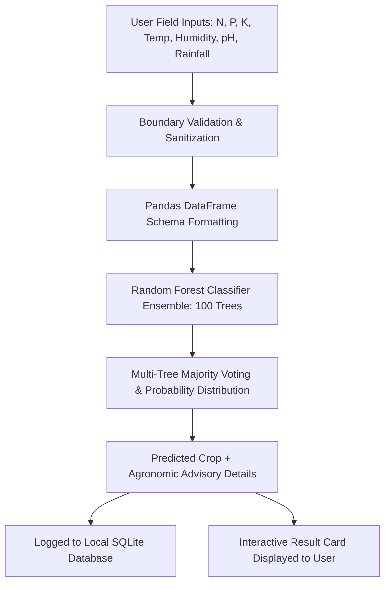

# AgriPredict AI — Smart Crop Classification & Recommendation System

[](https://www.python.org/)
[](https://flask.palletsprojects.com/)
[](https://scikit-learn.org/)
[](https://www.sqlite.org/)
[]()

> **AgriPredict AI** is a production-style, machine learning-powered agricultural advisory platform designed to recommend optimal crop varieties based on quantifiable soil chemistry and regional environmental variables.

---

## 📖 Table of Contents

- [Overview](#overview)
- [Key Features](#key-features)
- [Machine Learning Architecture](#machine-learning-architecture)
- [Dataset Specifications](#dataset-specifications)
- [Technology Stack](#technology-stack)
- [Project Structure](#project-structure)
- [Installation & Setup](#installation--setup)
- [Running the Application](#running-the-application)
- [How Prediction Works](#how-prediction-works)
- [API & Prediction Workflow](#api--prediction-workflow)
- [Future Enhancements](#future-enhancements)
- [Important Agronomic Disclaimer](#important-agronomic-disclaimer)

---

## 🌟 Overview

Modern precision agriculture requires intelligent decision support to optimize land utility, reduce fertilizer waste, and maximize food security. **AgriPredict AI** transforms empirical soil and atmospheric observations into immediate, scientifically grounded crop recommendations using an ensemble **Random Forest Classifier** trained on standard agronomic datasets.

The system is architected for:
- Academic capstone & final-year engineering demonstrations
- Machine learning portfolio showcases
- Agronomic advisory prototypes & farmer support demonstrations

---

## 🔐 Authentication & Application Flow

```text
Login / Signup (/login, /signup)
       ↓
Protected Dashboard (/dashboard)
       ↓
7 Clickable Feature Modules:
├── 1. Crop Prediction (/predict)
├── 2. Prediction History (/history)
├── 3. Dataset Explorer (/dataset)
├── 4. ML Model Information (/model)
├── 5. How It Works (/how-it-works)
├── 6. About Project (/about)
└── 7. User Profile (/profile)
```

### Pre-Configured Demo Credentials
* **Username:** `admin`
* **Password:** `password123`
*(Or register a new account on `/signup` with custom credentials).*

---

## ✨ Key Features

1. **Split-Screen Authentication System:**
   - Password hashing with PBKDF2-SHA256 (`werkzeug.security`).
   - Session-based protection: Unauthorized attempts to `/dashboard`, `/predict`, or `/history` automatically redirect to `/login`.

2. **100% Clickable SaaS Dashboard Hub:**
   - Every card on the dashboard is fully interactive with hover elevations, active states, and direct route navigation.
   - Comprehensive navigation bar & quick profile switch.

3. **User-Isolated Prediction History:**
   - Predictions are saved to `database/predictions.db` linked to the logged-in user's account.
   - Dedicated `/history` page with safe clear-history option.

4. **Intelligent Crop Recommendation:**
   - Evaluates **7 critical parameters**: Nitrogen (N), Phosphorus (P), Potassium (K), Temperature (°C), Humidity (%), Soil pH, and Rainfall (mm).
   - Generates predictions across **22 distinct crop classes** with ensemble confidence scoring.

2. **One-Click Demonstration Presets:**
   - Pre-configured agronomic profiles (e.g. Rice, Coffee, Cotton, Maize, Apple, Chickpea) allow swift one-click testing without manual typing.

3. **Interactive Prediction Dashboard:**
   - Chronological logging into a local **SQLite database** (`predictions.db`).
   - Summary telemetry including total predictions, top-recommended crops, and visual distribution charts.
   - Safe historical log clearing capability with user confirmation.

4. **Transparent Model Diagnostics:**
   - Real, un-faked test evaluation accuracy (**99.32%** on independent 80/20 train-test split).
   - Real-time Gini feature importance calculation (Rainfall: ~22.7%, Humidity: ~21.1%, Potassium: ~18.1%).

5. **Dynamic Dataset Explorer:**
   - Computes statistical moments (min, max, mean, std) and class counts directly from `Crop_recommendation.csv`.
   - Dynamic Chart.js distribution charts and searchable sample previews.

6. **Production UX & Responsive Layout:**
   - Modern agricultural color palette (emerald, forest green, warm gold, neutral slate).
   - Micro-animations, responsive layout across mobile, tablet, and desktop viewports.
   - Professional loading state with zero page flickering.

---

## 🤖 Machine Learning Architecture

- **Algorithm:** Random Forest Classifier (`sklearn.ensemble.RandomForestClassifier`)
- **Number of Estimators:** 100 Decision Trees
- **Splitting Criterion:** Gini Impurity
- **Input Dimension:** 7 Continuous Numeric Features
- **Target Dimension:** 22 Categorical Crop Classes
- **Evaluated Accuracy:** **99.32%** (Test split, $n=440$)
- **Overall Dataset Score:** **99.86%** ($N=2200$)

### Feature Importance Weights

| Parameter | Identifier | Relative Importance | Role in Plant Physiology |
|---|---|:---:|---|
| **Rainfall** | `rainfall` | **22.70%** | Governs seasonal root hydration and soil moisture tension |
| **Humidity** | `humidity` | **21.13%** | Regulates stomatal transpiration and fungal susceptibility |
| **Potassium (K)** | `K` | **18.12%** | Drives osmotic regulation, disease tolerance, and fruit fill |
| **Phosphorus (P)** | `P` | **14.36%** | Energy transfer (ATP), flowering, and early root elongation |
| **Nitrogen (N)** | `N` | **10.89%** | Amino acid synthesis, vegetative growth, and chlorophyll |
| **Temperature** | `temperature` | **7.57%** | Controls metabolic rate, germination, and thermal units |
| **Soil pH** | `ph` | **5.23%** | Regulates mineral solubility and micronutrient uptake |

---

## 📊 Dataset Specifications

The model utilizes `Crop_recommendation.csv`:
- **Total Records:** 2,200 observation rows
- **Class Balance:** Exactly 100 samples per crop (perfectly balanced 22-class benchmark)
- **Supported Crops (22):**
  - *Cereals:* Rice, Maize
  - *Pulses:* Chickpea, Kidney Beans, Pigeon Peas, Moth Beans, Mung Bean, Black Gram, Lentil
  - *Fruits & Horticulture:* Pomegranate, Banana, Mango, Grapes, Watermelon, Muskmelon, Apple, Orange, Papaya, Coconut
  - *Commercial Cash Crops:* Cotton, Jute, Coffee

---

## 🛠️ Technology Stack

- **Backend:** Python 3.10+, Flask 2.x / 3.x
- **Machine Learning:** Scikit-learn, NumPy, Pandas
- **Persistence:** SQLite (`predictions.db`), Python `pickle` serialization
- **Frontend:** Semantic HTML5, Vanilla CSS3 (Custom Design System), JavaScript (ES6+)
- **Data Visualization:** Chart.js (CDN-delivered)
- **Typography:** Google Fonts (Plus Jakarta Sans & Inter)

---

## 📁 Project Structure

```text
CROP_CLASSIFICATION/
│
├── app.py                      # Core Flask web server and routing controller
├── crop_catalog.py             # Agronomic intelligence metadata & validation engine
├── dataset_analyzer.py         # Dynamic CSV analytics & statistical aggregator
├── model_info.py               # ML model evaluation & feature importance inspector
├── model.py                    # Training script (Random Forest Classifier)
├── model.pkl                   # Trained model binary
├── Crop_recommendation.csv     # Agronomic benchmark dataset
├── requirements.txt            # Python dependencies
├── README.md                   # Project documentation
│
├── database/
│   ├── db.py                   # SQLite schema initialization and CRUD queries
│   └── predictions.db          # Auto-generated SQLite database
│
├── templates/
│   ├── base.html               # Master layout with responsive navbar & footer
│   ├── index.html              # Landing / hero page with features and crop showcase
│   ├── crop.html               # Crop prediction form, presets, and result card
│   ├── dashboard.html          # Telemetry stats, charts, and prediction logs
│   ├── how-it-works.html       # 5-step visual workflow & parameter breakdown
│   ├── model.html              # Model specifications and genuine accuracy stats
│   ├── dataset.html            # Dynamic CSV statistics and class distribution chart
│   ├── about.html              # System architecture, benefits, and contact section
│   └── error.html              # Friendly 404/500 error view
│
└── static/
    ├── css/
    │   └── style.css           # Production CSS design tokens and responsive grid
    ├── js/
    │   └── main.js             # Mobile nav, autofill presets, validation, and loaders
    └── images/
        └── crop.jpg            # Static banner asset
```

---

## 🚀 Installation & Setup

### 1. Prerequisites
Ensure **Python 3.10+** is installed on your workstation.

### 2. Clone / Open Directory
```bash
cd CROP_CLASSIFICATION
```

### 3. Install Dependencies
```bash
pip install -r requirements.txt
```

---

## 💻 Running the Application

Execute the Flask application:

```bash
python app.py
```

The web server will initialize the SQLite database automatically and serve the application locally at:
👉 **`http://127.0.0.1:5000`**

---

## 🌾 How Prediction Works



1. **Step 1 — Input Ingestion:** User enters or autofills 7 numerical agronomic attributes.
2. **Step 2 — Data Validation:** Validates that parameters satisfy biological feasibility constraints (e.g. $0 \le \text{pH} \le 14$).
3. **Step 3 — Model Inference:** Formats input into a DataFrame matching model feature names and runs `model.predict()`.
4. **Step 4 — Metadata Enrichment:** Pairs prediction with scientific name, water requirements, and season duration.
5. **Step 5 — Persistence & Rendering:** Logs the transaction to `database/predictions.db` and renders the result card.

---

## 🔮 Future Enhancements

- [ ] Weather API integration to auto-populate regional ambient temperature, humidity, and rainfall based on GPS location.
- [ ] Multi-crop suitability ranking (Top-3 recommended alternative crops).
- [ ] Fertilizer deficit calculator suggesting exact NPK fertilizer quantities.
- [ ] Export prediction history to PDF and CSV reports.

---

## ⚠️ Important Agronomic Disclaimer

**AgriPredict AI** provides data-driven statistical crop recommendations based on historical empirical agricultural records. Predictions are intended as an advisory and decision-support reference. They should **not** be construed as a guarantee of crop yield, harvest success, or profitability. Real-world crop outcomes depend on seed quality, local irrigation practices, micro-climates, soil microbiological health, and pest management. For critical agricultural operations, always consult local agronomic specialists and perform certified laboratory soil tests.
